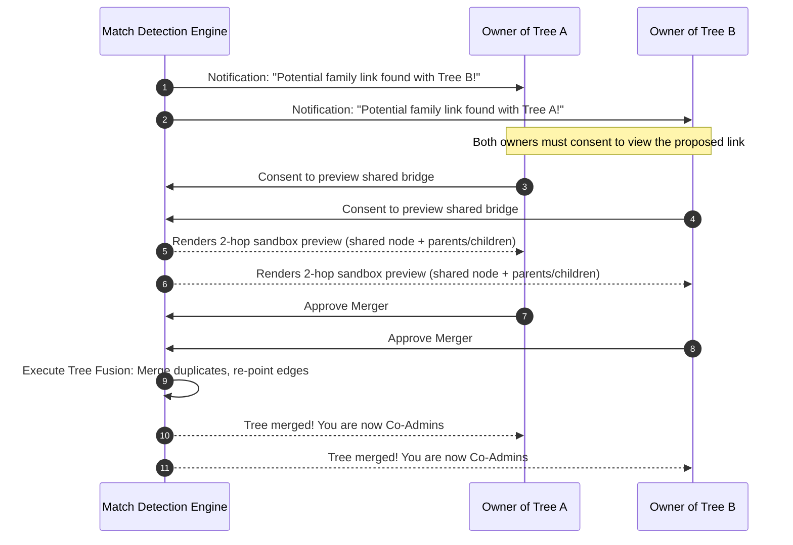

# AncestryArc — Master Project Log & Architectural Vision

> **Living Documentation**: This document tracks the core concepts, completed milestones, ongoing architectural designs, scale strategies, and future roadmap for AncestryArc. It is maintained and updated across development sessions.

---

## 1. Vision & Core Concept

**AncestryArc** is designed to transcend traditional, isolated family tree software. 

### The Evolution Stages:
1. **Phase 1: Individual & Immediate Family**: Deep, granular lineage mapping (step-parents, multiple marriages, complex adoptions, village origins, custom attributes).
2. **Phase 2: Community & Village Scale**: Scaling horizontally to map an entire village or interconnected community where multiple family lines cross and intermarry over centuries.
3. **Phase 3: Scalable Global Lineage Network**: A decentralized/federated network where independent users around the world build their respective family trees. When the system identifies common links across independent accounts, it facilitates **secure, mutual-consent tree mergers** and **granular field-level privacy permissions**.

---

## 2. Tech Stack & Architecture

- **Core Framework**: React 19 + Vite 8
- **Routing**: `react-router-dom` with GitHub Pages base URL compatibility
- **Visualization Engines**:
  - **Global Web**: `react-force-graph-2d` (d3-force physics engine with generational gravity dagMode)
  - **Hierarchical Lineage Tree**: `@xyflow/react` (ReactFlow) + `dagre` directed graph auto-layout
- **Motion & Micro-interactions**: `framer-motion`
- **Iconography**: `lucide-react`
- **Design System**: Handcrafted design tokens, CSS variables, glassmorphism cards, responsive dark/light theme engine, and Inter typography.

---

## 3. What Has Been Completed

### Visual & UX Foundation (Phase 1 & 2 Upgrade)
- [x] **Typography & Color Tokens**: Integrated Google Fonts `Inter`, created CSS variables for primary/secondary gradients, glassmorphism surfaces (`backdrop-filter`), and responsive dark mode colors.
- [x] **Dynamic Family Metrics**: Dashboard computes real-time topological statistics:
  - Total Members
  - Generational Depth (recursive ancestor/descendant graph traversal)
  - Kinship Links (biological parents, adoptive ties, marriages)
  - Ancestral Villages tracked
- [x] **Modern View Controls**:
  - Pill-shaped tab navigation between *Global Web* and *Full Lineage Tree*.
  - Inline Generational Gravity iOS-style toggle.
  - Smart search bar with auto-closing outside-click listeners, clear button, and multi-field matching (name, ID, village).
- [x] **Zero-State Experience**: Aesthetic welcoming card for new or empty family databases.

### Visualizations & Physics Engine (Phase 3)
- [x] **Dark Mode Synchronization**:
  - `GlobalGraph`: Union nodes, directional links, and canvas background dynamically adapt between light and dark modes.
  - `LineageTree`: Node label backgrounds adapt to theme surface colors instead of hardcoded white rectangles.
  - MiniMap and background dot grids respect theme boundaries.
- [x] **Responsive Canvas**: Added active window resize listeners to `GlobalGraph` so the canvas dynamically resizes with the browser viewport.
- [x] **Layout Cache Fix**: Eliminated the module-level Dagre singleton in `LineageTree` to prevent stale node caching when modifying tree elements.
- [x] **High-Aesthetic Gradient Nodes**: Accent pink gradient with glow for the root person; purple/violet gradient for relatives.

### Data Management & Forms (Phase 4 & 5)
- [x] **Single-Member Export**: Recursive JSON extraction downloading all direct ancestors, direct descendants, and their spouses for any clicked individual.
- [x] **Global CSV Export**: Instant generation and download of complete family records into `.csv`.
- [x] **Delete Confirmation**: Added an inline two-step confirmation step to `SidePanelEdit` to prevent accidental loss of member records.
- [x] **Security Route Bug Fix**: Corrected broken `person.createdBy !== 'currentUser'` check in `EditPerson.jsx` so owners can edit via direct `/edit/:id` URLs.
- [x] **Responsive Form Layout**: Fixed cramped 5-column grid in `PersonInput` to fluidly wrap on laptop and mobile viewports.
- [x] **Bulk Spreadsheet Expansion**: Added "Add 5 Rows" button to `BulkEntry` with temporary ID to system ID automatic relational resolution.
- [x] **Flow-First Layout & Maximize Canvas**:
  - Replaced the screen-eating vertical stat cards with a sleek, horizontal toolbar and minimalist stats pill (`39 Members • 6 Generations • 46 Connections`).
  - Added a one-click **"Maximize Flow" / Fullscreen** toggle button (`Maximize2` / `Minimize2` or `Esc`) that expands the graph to full 100vw × 100vh canvas mode.
  - Resolved flex-column layout issue where the canvas was being squeezed into a narrow right-side sliver.
- [x] **Display Name & Nick Name Support**:
  - Added dedicated `displayName` and `nickname` properties across all models (`PersonInput`, `SidePanelEdit`, `BulkEntry`, graph nodes, CSV, and JSON exports).
- [x] **Legible Lineage Tree Cards**:
  - Replaced microscopic 50px circles with structured **160px × 56px genealogical cards** displaying bold primary names and subtitle tags for nicknames/birth years.
  - Reduced `fitView` padding from `0.5` to `0.12` with scale compensation for instant readability without zooming.
  - Eliminated "Lineage Member" placeholder text entirely.
  - Strictly prioritized Display Name over Legal/Full Name whenever provided.
  - Enabled automatic zoom-in when clicking a node, and instant right-pane collapse + full-tree zoom-out when clicking outside on empty canvas space (`onPaneClick` / `onBackgroundClick`).
- [x] **Global Web Canvas Overhaul & Instant Hover Cards**:
  - Enforced finite-coordinate guard clauses in `drawNode` to eliminate initial-tick canvas crashes.
  - Replaced sluggish browser tooltips with a zero-latency floating HTML hover card and direct-on-canvas legible labels.
- [x] **Default 39-Member Village Dataset Bundled**:
  - Embedded `defaultFamilyData.json` into the repository so fresh deployments on GitHub Pages or new devices load all 39 records by default.
  - Added one-click JSON backup export and restore file upload to the dashboard.
  - Implemented automatic upgrade detection for users whose browsers held legacy 3-member mock cache.
- [x] **Firebase Integration & Google Sign-In**:
  - Installed and configured `@firebase` SDK with Auth and Cloud Firestore.
  - Added `AuthProvider` with Google popup sign-in, user profile badge, and cloud synchronization status.
  - Built real-time Firestore synchronization (`subscribeToFamilyLineage`, `savePersonToFirestore`, `deletePersonFromFirestore`, `uploadFullTreeToFirestore`).
- [x] **Automated GitHub Actions Deployment**:
  - Created `.github/workflows/deploy.yml` to automatically build and deploy `master` commits to GitHub Pages on every push.

---

## 4. Deep-Dive: Architectural Solutions for Your 2 Long-Term Questions

### Question 1: Village-to-Global Scale, Autonomous Link Detection & Tree Merging

> **Your Requirement**:
> *Scale from family to village to the entire world. When separate accounts build trees that overlap, the system should intelligently detect the match, notify both owners, allow them to inspect a 2-hop radius around the shared node, and if both agree, merge the trees into one unified tree where both owners become co-admins.*

#### A. Scalable Data Architecture: Multi-Tenant Graph Database
To scale beyond `localStorage` to an entire village (thousands of nodes) and eventually global scale (millions of nodes):
1. **Backend Model**: Move from monolithic JSON blobs to an edge-list graph schema (e.g., Firebase Firestore with subcollections, Supabase PostgreSQL with relational foreign keys, or Neo4j graph DB).
2. **Global Entity Identifiers**:
   - `PersonID` (UUID / Base62)
   - `TreeID` (Partitioned family/village namespace)
   - `OwnerIDs` (Array of user IDs with co-admin privileges)

#### B. Autonomous Link Detection (The "Entity Resolution" Engine)
Rather than brute-force comparison, an asynchronous background matching service will score person similarity across trees:
- **Heuristic Matching Matrix**:
  - Exact or phonetic match on Full Name (Double Metaphone / Soundex for regional names).
  - Date of Birth window (+/- 1-2 years).
  - Ancestral Village match (crucial for village-scale linkage).
  - **Topological Symmetry**: If Person A in Tree 1 and Person B in Tree 2 have matching names *and* their parents or spouses also match, the confidence score reaches `>95%`.

#### C. The Two-Sided "Bridge Reveal" Workflow (Privacy-First)


1. **Detection Flag**: When similarity score exceeds threshold (e.g. 85%), both owners receive a **"Potential Link Detected"** notification.
2. **Sandboxed 2-Hop Inspection**:
   - Neither tree is exposed entirely.
   - The system displays a sandboxed visual preview showing only the flagged node, 2 hops up (grandparents), 2 hops down (grandchildren), and 1 hop sideways (spouses).
   - Sensitive contact details (phone, email) remain masked during preview.
3. **Merger Execution & Co-Admin Governance**:
   - If both confirm:
     - Duplicate nodes are merged into single canonical nodes with an alias history.
     - Both user IDs are appended to the merged tree's `coAdmins` array (`coAdmins: [userA_id, userB_id]`).
     - Conflict resolution: If Tree A listed birth as 1945 and Tree B listed 1946, both records are stored as "Alternative Dates / Citations" until co-admins align.

---

### Question 2: Field-Level Confidentiality & "Request to Reveal" Protocol

> **Your Requirement**:
> *If a person wants to see confidential information (e.g. phone number, exact address) from another flow/branch, they can click "Request to Reveal". The flow owner receives a notification and can approve or decline. Users can choose what is public vs confidential.*

#### A. Three-Tier Privacy Hierarchy per Person Record
Each person record will contain access classification tags on attributes:

| Tier | Default Fields | Who Can See It? |
|---|---|---|
| **Tier 1: Public / Lineage Tier** | Full Name, Gender, Initials, Generation Depth, Lineage Links (Mother, Father, Spouse) | Anyone browsing the community/village web |
| **Tier 2: Community Tier** | Birth Year, Ancestral Village, General Notes, Historical Stories | Verified members belonging to the same extended tree |
| **Tier 3: Confidential Tier** | Phone Number, Email, National ID, Exact Street Address, Living Status, Private Custom Fields | Only Node Creator & Explicitly Authorized Users |

#### B. The "Request to Reveal" Workflow
1. **Confidential Masking**:
   - When User X views a node owned by User Y, fields in Tier 3 are masked (e.g. `Phone: •••••••••••` with a **"Request Access"** lock icon).
2. **Notification Dispatch**:
   - Clicking "Request Access" creates a pending request ticket:
     ```json
     {
       "requestId": "req_8829",
       "requesterId": "user_keshav",
       "targetPersonId": "person_104",
       "requestedFields": ["phone", "email"],
       "reason": "I am Michael's grandson researching our branch",
       "status": "pending"
     }
     ```
3. **Owner Decision UI**:
   - Owner Y opens their notification center:
     > *"Keshav is requesting access to view the Phone Number and Email for Michael Doe."*
   - Owner Y can check:
     - [x] Allow Phone Number
     - [ ] Allow Email
     - **Permission Scope**: "One-time view" OR "Permanent access for Keshav".
4. **Instant Unlock**:
   - Upon approval, client state updates, decrypting/revealing the authorized field for User X in their lineage view.

---

## 5. Upcoming Roadmap & Next Steps

### Short-Term (Immediate Priorities)
- [ ] **Multi-Tree Project Switcher**: Allow creating separate trees (e.g. "My Family", "Village North Branch", "Village South Branch") within the app.
- [ ] **Data Model Extension**: Add explicit `isLiving` flag, death date, and field-level visibility flags (`public`, `community`, `confidential`) to `PersonInput`.
- [ ] **Notification Center UI Mockup**: Create a floating bell icon and interactive notifications tray to test the "Request to Reveal" and "Bridge Link" approval flow.

### Medium-Term (Cloud & Multi-User)
- [ ] **Firebase Authentication & Firestore Sync**: Transition `localStorage` to real-time multi-tenant cloud storage.
- [ ] **Per-Branch Permission Enforcement**: Automatically restrict visibility based on user session and tree ownership.
- [ ] **Bridge Matching Background Worker**: Algorithm to scan separate tree collections and flag potential person matches.

### Long-Term (Global Scale)
- [ ] **Interactive Tree Merging Studio**: Split-screen diffing tool to review two converging branches side-by-side before finalizing co-admin merger.
- [ ] **End-to-End Encryption (E2EE)**: Sensitive confidential fields encrypted with public-key cryptography so only authorized family members hold decryption keys.
- [ ] **AI-Powered Oral History to Tree**: Voice or text parser converting spoken village stories into auto-populated lineage nodes.
